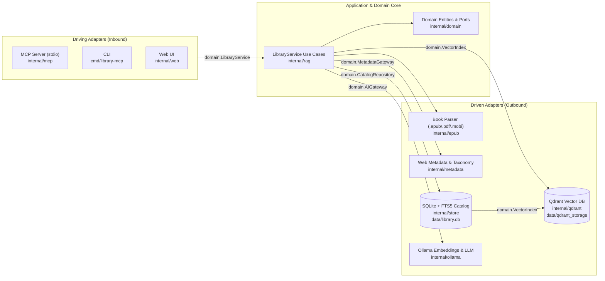

# Library MCP

**Library MCP** is a 100% local, structure-aware **Parent-Child Hierarchical RAG** engine and **Model Context Protocol (MCP)** server for technical books (`.epub`, `.pdf`, `.mobi`, `.azw`, `.azw3`). Written in pure **Go** (`CGO_ENABLED=0` with pure-Go SQLite + FTS5), it turns your personal ebook folder into a searchable, cited knowledge base that AI coding assistants (Antigravity, Claude Desktop, Claude Code, Cursor) and humans (via CLI or Web UI) can query in real time.

---

## What It Does & Why It Exists

Standard naive RAG pipelines split books into fixed 500-character slices. For technical books, this breaks code blocks in half, strips section headers, and loses surrounding architectural explanations.

**Library MCP** solves this by combining **structure-aware two-tier indexing**, **hybrid dense + sparse retrieval**, and **automatic bibliographic enrichment**:

1. **Multi-Format Recursive Ingestion (`.epub`, `.pdf`, `.mobi`, `.azw3`)**:
   - Recursively scans your configured books directory (and all nested subfolders) for `.epub`, `.pdf`, `.mobi`, `.azw`, and `.azw3` files.
   - Computes a **SHA-256 fingerprint** of every book file so subsequent runs automatically skip unchanged books and only index new additions.
   - Preserves fenced code blocks (`<pre><code>`), converts HTML tables to Markdown tables, and retains chapter/section hierarchy.
2. **Parent-Child Hierarchical RAG**:
   - **Parent Sections (~3,200 chars)**: Complete, coherent book subsections with full code listings and `[Book | Author | Chapter | Section]` breadcrumbs.
   - **Child Chunks (~650 chars, 120-char overlap)**: Fine-grained search units linked to their `ParentID`.
   - At query time, searches match fine-grained **Child Chunks**, then **promote and deduplicate** hits to their **Parent Sections**—boosting parent sections where multiple child chunks match (`score += child_score * 0.20`) so the AI receives complete context instead of fragmented snippets.
3. **Qdrant Hybrid Search (Dense + Sparse RRF) with Resilient Local Fallback**:
   - Indexes both **Dense embeddings** (via local Ollama `bge-m3`) and **Sparse BM25 vectors** (with technical tokenization that preserves identifiers like `io.LimitReader`, `C++`, `UTF-8`, `bge-m3`) into **Qdrant** using Reciprocal Rank Fusion (RRF).
   - Maintains a synchronized local **SQLite + FTS5** database (`data/library.db`) and vector cache (`data/vectors.bin`) so full-text search, chapter/TOC queries, and MCP tools run in milliseconds and keep working seamlessly even if Docker/Qdrant or Ollama is offline.
4. **Automatic Web Metadata Enrichment, Categorization & Tagging**:
   - Extracts embedded OPF/EXTH/PDF metadata and ISBNs, then queries **Google Books** and **Open Library** to populate canonical **Title, Subtitle, Author, Publisher, Published Year, ISBN-13, Page Count, Description, Cover URL, and Web URL**.
   - Classifies every book into a primary **Category** (`AI & Machine Learning`, `Security & Cryptography`, `Software Architecture & Design`, `Software Engineering & DevOps`, `Data Engineering & Databases`, `Systems & Networking`) and assigns up to 8 normalized technical **Tags** (`rag`, `llm`, `domain-driven-design`, `xss`, `ci-cd`, etc.) using book metadata, chapter titles, and parent folder names.
5. **Three Interfaces in One Binary**:
   - **MCP Server (`library-mcp mcp`)**: Exposes **14 MCP Tools** (`search_books`, `list_books`, `get_book_toc`, `search_chapters`, `get_chapter`, `compare_books_on_topic`, `extract_code_examples`, `deduplicate_books`, `save_note`, `list_notes`, `delete_note`, `export_dossier`, `enrich_books`, `remove_book`, `ingest_books`, `ask_library`), **MCP Resources** (`resources/list`, `resources/read`), and **MCP Prompts** (`prompts/list`, `prompts/get`) over `stdio` JSON-RPC 2.0.
   - **Command-Line Interface (`library-mcp <cmd>`)**: Fast CLI (<15ms cold start backed by SQLite `data/library.db` + FTS5) for ingesting, enriching, searching, comparing books, extracting code examples, deduplicating editions, managing notes, exporting study dossiers, watching folders, and syncing to Qdrant.
   - **Local Web UI (`library-mcp serve`)**: Dark-mode three-pane research interface (`http://127.0.0.1:8765`) with live background folder watcher, book catalog, hybrid search, RAG Q&A, study notes & dossier generator, and a full chapter reader.

---

## Architecture Overview (Hexagonal / Ports & Adapters)

The project follows **Domain-Driven Design (DDD)** and **Hexagonal Architecture (Ports & Adapters)** in idiomatic Go:

- **Domain & Ports Core (`internal/domain`)**: Pure domain entities (`ParsedBook`, `BookRecord`, `ParentSection`, `ParsedChunk`, `NoteRecord`, `BookTOC`) and port interfaces (`LibraryService`, `CatalogRepository`, `VectorIndex`, `AIGateway`, `MetadataGateway`) with zero external dependencies.
- **Application Layer (`internal/rag`)**: Implements `domain.LibraryService`, orchestrating multi-format ingestion, Parent-Child RAG retrieval, cross-book comparisons, code extraction, study dossiers, and live folder watching via driven ports.
- **Driving Adapters (Inbound)**:
  - `cmd/library-mcp`: CLI & Composition Root
  - `internal/mcp`: MCP JSON-RPC 2.0 `stdio` Server
  - `internal/web`: Local Web UI & REST API Server
- **Driven Adapters (Outbound)**:
  - `internal/store`: SQLite + FTS5 Catalog Repository (`domain.CatalogRepository`)
  - `internal/qdrant`: Qdrant Hybrid Vector Index (`domain.VectorIndex`)
  - `internal/ollama`: Local Ollama Embeddings & Chat Gateway (`domain.AIGateway`)
  - `internal/metadata`: Google Books & Open Library Metadata + Taxonomy Classifier (`domain.MetadataGateway`)
  - `internal/epub`: Multi-Format Book Parser (`.epub`, `.pdf`, `.mobi`, `.azw3`)



---

## SQLite (`data/library.db`) vs. Qdrant: What Each One Does (In Plain English)

When the program reads a book, it splits the book into three sizes:
1. **Whole Chapters** (10–30 pages of text — used when you want to read an entire chapter).
2. **Medium Sections ("Parent Sections")** (~1–2 pages of text — big enough to hold a complete explanation and a full code example without cutting it in half).
3. **Small Paragraphs ("Child Chunks")** (a single short paragraph — small enough to accurately match a specific question).

To keep searches fast and accurate across large ebook collections, the project uses two databases that each do what they are best at:

### 1. What SQLite (`data/library.db`) Is For: **The Library Catalog & Book Text Storage**
Think of **SQLite** as the actual **library shelves and card catalog** stored in a single local file (`data/library.db`):
- **Stores all the book text and structure**: Every book's title, author, category, tags, table of contents, full chapters, medium sections, and your personal notes live here.
- **Instant lookups by ID or filter**: When you ask *"Show me all books in the Security category"*, *"Show me the Table of Contents of Book X"*, or *"Open Chapter 3"*, SQLite answers in a few milliseconds.
- **Built-in Keyword Search (Works without Docker)**: SQLite also maintains a built-in word search index. If you search for exact words like `"io.LimitReader"` or `"bounded context"`—or if Docker is turned off—SQLite searches all paragraphs by keywords on its own in a fraction of a second.

### 2. What Qdrant (`data/qdrant_storage/`) Is For: **Searching by Meaning ("AI Concept Search")**
Think of **Qdrant** as a specialized **AI index that understands meaning, not just exact words**:
- **Finds ideas even when the words don't match**: Suppose you search for *"how to stop a service from overloading when another server fails"*. A book might call that a *"circuit breaker pattern"* without ever using the word *"overloading"*. Keyword search would miss it, but Qdrant finds it because their **meaning** (represented as number vectors created by Ollama) is close.
- **Only stores the small paragraphs**: Full chapters are not duplicated inside Qdrant because that would waste gigabytes of memory. Instead, Qdrant only indexes the small paragraphs and remembers which **Medium Section ID** (`parent_id`) each paragraph came from.

### 3. How They Work Together When You Search
1. **Qdrant finds the matching paragraph**: You ask a question. Qdrant searches the small paragraphs by **meaning + keywords** and finds the best matches.
2. **SQLite fetches the complete surrounding section**: Instead of giving you (or your AI assistant) just one tiny paragraph where a code block might be cut off, the program takes the matching paragraph's section ID and asks **SQLite** for the full **1–2 page Medium Section** (`Parent Section`), plus the book's metadata and any notes you saved.
3. **If Qdrant/Docker isn't running**: The program automatically falls back to **SQLite's built-in keyword search**, so everything still works offline without Docker.

| Question / Action | Which Database Handles It? |
| :--- | :--- |
| List books, filter by category/tag/author, view Table of Contents | **SQLite** (`data/library.db`) |
| Read a full chapter or save/search personal notes | **SQLite** (`data/library.db`) |
| Search books by **meaning / concept** (when Docker + Ollama are running) | **Qdrant** finds the paragraph $\rightarrow$ **SQLite** returns the full section |
| Search books by **keywords** (or anytime Docker is turned off) | **SQLite** (`data/library.db`) |

---

## Where Data & Qdrant Live (and How to Inspect Qdrant)

All runtime data is stored inside the `./data` folder of the repository:

| Path | Description |
| :--- | :--- |
| `data/qdrant_storage/` | **Qdrant Vector Database storage volume** mounted into the `library-mcp-qdrant` container (`/qdrant/storage`). Holds Qdrant's collections, HNSW dense vector indexes, sparse inverted indexes, and payloads. |
| `data/library.db` | **SQLite + FTS5 Database** (`WAL` mode) storing all `books`, `chapters`, `parents` (~3,200-char parent sections), `chunks` (~650-char child chunks), `notes`, and the `chunks_fts` full-text search index for sub-50ms queries with minimal RAM usage. |
| `data/catalog_meta.json` | Lightweight JSON snapshot of book metadata, categories, tags, and notes for quick inspection. |
| `data/vectors.bin` | Local binary float32 embedding cache. Allows instant offline vector search and lets you push all indexed chunks to Qdrant anytime via `library-mcp sync`. |
| `data/uploads/` | Books uploaded directly through the Web UI. |

### How to See Inside Qdrant

1. **Ensure Qdrant is running and synced**:
   ```bash
   docker compose up -d
   ./library-mcp sync
   ```
2. **Open the Qdrant Web Dashboard (Visual UI)**:
   - Visit **`http://127.0.0.1:6333/dashboard`** in your browser.
   - Click on the **`smart_library_chunks`** collection (`http://127.0.0.1:6333/dashboard#/collections/smart_library_chunks`) to browse individual points, inspect child chunk payloads (`book_title`, `chapter_title`, `section_title`, `parent_id`, `text`), view vector dimensions, and run interactive queries in the **Console** tab.
3. **Query Qdrant Directly via REST API**:
   ```bash
   # Check collection status and point count
   curl http://127.0.0.1:6333/collections/smart_library_chunks

   # Scroll through stored child chunk points and their payloads
   curl -X POST http://127.0.0.1:6333/collections/smart_library_chunks/points/scroll \
     -H "Content-Type: application/json" \
     -d '{"limit": 5, "with_payload": true, "with_vector": false}'
   ```

---

## 1. Installation & Build (Linux, WSL & Windows)

### A. Linux / WSL (Bash / Zsh)
```bash
# 1. Start Qdrant Vector DB (REST API: 127.0.0.1:6333 | Dashboard: http://127.0.0.1:6333/dashboard)
docker compose up -d

# 2. Pull the embedding model (bge-m3) and chat model in Ollama
ollama pull bge-m3
ollama pull qwen2.5-coder:14b

# 3. Format, test, and build the Linux binary (or run `make build-linux`)
gofmt -w .
go test ./...
go build -o library-mcp ./cmd/library-mcp
```

### B. Windows (PowerShell / CMD)
```powershell
# 1. Start Qdrant Vector DB
docker compose up -d

# 2. Pull the embedding model (bge-m3) and chat model in Ollama
ollama pull bge-m3
ollama pull qwen2.5-coder:14b

# 3. Format, test, and build the Windows executable
gofmt -w .
go test ./...
go build -o library-mcp.exe .\cmd\library-mcp
```

---

## 2. CLI Usage Guide

```bash
# Recursively scan configured books_dir for .epub, .pdf, .mobi, .azw, .azw3
./library-mcp ingest          # Linux / WSL
.\library-mcp.exe ingest      # Windows

# Ingest from any custom folder (recursively)
./library-mcp ingest --dir ~/Books

# Force re-index all books
./library-mcp ingest --force

# Fetch/refresh web metadata (Google Books + Open Library), categories & tags
./library-mcp enrich --force

# List indexed books (with optional category or tag filters)
./library-mcp books
./library-mcp books --category "Security"
./library-mcp books --tag "rag"

# Remove a book by ID, title, ISBN, or filename (or --all)
./library-mcp remove "Web Application Security"
./library-mcp remove cccc4eb9935d74e0

# Search books from the terminal (with category, tag, author, year, per-book diversity, or code-only filters)
./library-mcp search --category "Architecture" --max-per-book 2 "bounded context ubiquitous language"
./library-mcp search --code-only --tag "golang" "concurrency worker pool"

# Inspect a book's full hierarchical Table of Contents
./library-mcp toc "Designing Data-Intensive Applications"

# Search across all chapter and section headings
./library-mcp chapters --category "Security" "authentication"

# Compare perspectives on a topic across distinct books & authors (1 per book + MMR diversity)
./library-mcp compare --max-books 5 "microservices vs modular monolith"

# Extract code examples, CLI commands, and technical patterns
./library-mcp code --lang "golang" "context cancellation"

# Detect and optionally remove duplicate book editions
./library-mcp dedup
./library-mcp dedup --apply

# Save and search personal/agent notes & bookmarks
./library-mcp notes add --title "DDD Aggregates" --book "Domain-Driven Design" "Reference other aggregates only by identity."
./library-mcp notes list

# Compile a comprehensive Markdown Study Guide / Technical Dossier
./library-mcp dossier --out dossier_zero_trust.md "Zero Trust Architecture"

# Watch configured books folder for new/modified files and auto-index
./library-mcp watch

# Ask a question answered by local Ollama with citations
./library-mcp ask "How do LSM-trees compare to B-trees for write throughput?"

# Push all locally cataloged chunks & vectors into Qdrant
./library-mcp sync

# Check Qdrant, Ollama, and catalog status
./library-mcp status

# Start the local Web UI on http://127.0.0.1:8765
./library-mcp serve
```

---

## 3. Running as an MCP Server (Linux & Windows)

The binary includes a built-in **Model Context Protocol (MCP)** server (`library-mcp mcp`) over `stdio` JSON-RPC 2.0.

### A. Linux / WSL MCP Configuration (`mcp_config.json`)
```json
{
  "mcpServers": {
    "library-mcp": {
      "command": "/path/to/library-mcp/library-mcp",
      "args": ["mcp"],
      "env": {
        "LIBRARY_MCP_CONFIG": "/path/to/library-mcp/config.json"
      }
    }
  }
}
```

### B. Windows MCP Configuration (`mcp_config.json`)
```json
{
  "mcpServers": {
    "library-mcp": {
      "command": "C:\\path\\to\\library-mcp\\library-mcp.exe",
      "args": ["mcp"],
      "env": {
        "LIBRARY_MCP_CONFIG": "C:\\path\\to\\library-mcp\\config.json"
      }
    }
  }
}
```

### Tools, Resources & Prompts Exposed via MCP
1. **`search_books`** (`query`, optional `book_filter`, `category`, `tag`, `author`, `year_min`, `max_per_book`, `code_only`, `top_k`):
   Runs Qdrant Hybrid Search (Dense `bge-m3` + Sparse BM25 RRF) with **MMR Cross-Book Diversity** and returns **promoted Parent Sections** (~3,200 chars each, with complete code blocks and `[Book > Chapter > Section]` metadata).
2. **`list_books`** (optional `category`, `tag`, `author`, `year_min`):
   Lists all books currently indexed in your library along with their **Category**, **Tags**, **Publisher**, **Year**, **ISBN**, and **Metadata Source**.
3. **`get_book_toc`** (`book_id`):
   Returns a book's full hierarchical Table of Contents (all chapters and nested parent section headings with their IDs and sizes).
4. **`search_chapters`** (`query`, optional `book_filter`, `category`, `tag`, `top_k`):
   Searches specifically across all chapter titles and section headings before pulling full text.
5. **`get_chapter`** (`chapter_id`):
   Fetches the full text of a chapter when the AI agent needs to read beyond a single section.
6. **`compare_books_on_topic`** (`topic`, optional `category`, `tag`, `max_books`):
   Retrieves the top Parent Section from distinct books (`MaxPerBook: 1` with MMR diversity) to synthesize contrasting author perspectives.
7. **`extract_code_examples`** (`query`, optional `language`, `book_filter`, `category`, `top_k`):
   Filters specifically for sections containing source code examples, CLI commands, SQL queries, or implementation patterns.
8. **`deduplicate_books`** (optional `apply`):
   Detects duplicate editions across the library (by ISBN or canonical `Title + Author`) and optionally removes lower-quality duplicates.
9. **`save_note` / `list_notes` / `delete_note`**:
   Saves and queries persistent bookmarks, highlights, and architectural notes linked to specific books/chapters/sections (automatically included in future RAG context).
10. **`export_dossier`** (`topic`, optional `category`, `tag`, `output_path`, `top_k`):
    Compiles a structured Markdown Study Guide / Technical Dossier combining multi-book excerpts, code examples, recommended chapters, and saved notes.
11. **`enrich_books`** & **`remove_book`**:
    Enriches books with live web metadata or removes books by ID, title, ISBN, or filename.
12. **MCP Resources (`resources/list`, `resources/read`) & Prompts (`prompts/list`, `prompts/get`)**:
    Exposes `library://catalog/overview`, `library://catalog/notes`, `library://catalog/duplicates`, and dynamic per-category resources (`library://category/<slug>`), plus built-in grounded prompts (`architecture-review`, `security-audit`, `code-refactoring`, `topic-study-guide`).
